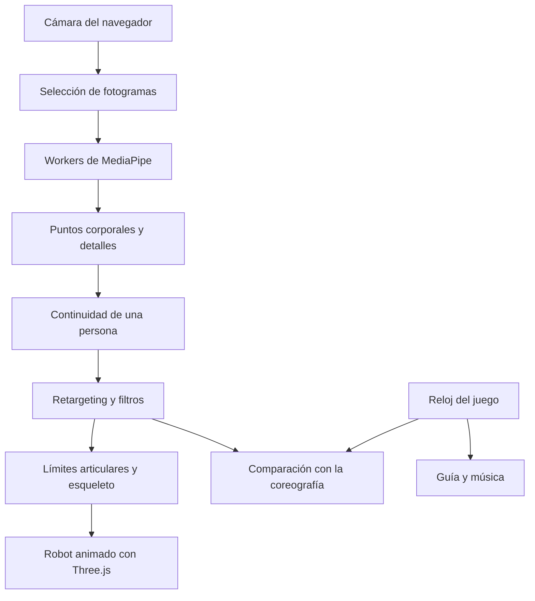

# Robot-Lagan · Samurái 3D

**De una cámara web a un robot que sigue tu movimiento.** Robot-Lagan es un proyecto educativo de visión por computador, animación 3D y juego de baile desarrollado por [Nicolas1609-1](https://github.com/Nicolas1609-1).

La aplicación estima el cuerpo, las manos y el rostro en el navegador y transforma esas medidas en movimientos de un samurái articulado. También incluye **Pulso Samurái**, una demo de baile con guía, música original y puntuación.

- [Abrir el estudio](https://lagan.nicolas16.life/)
- [Probar la demo de baile](https://lagan.nicolas16.life/?modo=baile)
- [Ver el repositorio](https://github.com/Nicolas1609-1/Robot-Lagan)

La versión actual usa una **cámara web y MediaPipe**. No necesita Kinect, sensores de profundidad ni un programa de Python en ejecución. Los modelos de detección son modelos preentrenados de MediaPipe; el proyecto implementa su integración, el seguimiento, la animación y el juego.

## Contenido

1. [Qué puedes hacer](#qué-puedes-hacer)
2. [Instalar y ejecutar](#instalar-y-ejecutar)
3. [Primera sesión con cámara](#primera-sesión-con-cámara)
4. [Controles y perfiles](#controles-y-perfiles)
5. [Demo de baile](#demo-de-baile)
6. [Cómo funciona](#cómo-funciona)
7. [Esqueleto y movimiento del robot](#esqueleto-y-movimiento-del-robot)
8. [Rendimiento y CPU/GPU](#rendimiento-y-cpugpu)
9. [Organización del código](#organización-del-código)
10. [Aprender y ampliar el proyecto](#aprender-y-ampliar-el-proyecto)
11. [Pruebas](#pruebas)
12. [Compilar y desplegar](#compilar-y-desplegar)
13. [Problemas frecuentes](#problemas-frecuentes)
14. [Privacidad, límites y referencias](#privacidad-límites-y-referencias)

## Qué puedes hacer

| Función | Comportamiento actual |
| --- | --- |
| Cuerpo completo | Sigue brazos, torso, pelvis, rodillas y pies cuando están visibles. |
| Manos articuladas | Interpreta orientación de palma, dedos y pulgar; reconoce gestos como puño y palma abierta. |
| Rostro | Anima orientación de cabeza, boca, sonrisa, párpados y cejas cuando el detector facial está activo. |
| Saltos | Calibra el suelo, estima despegue y aterrizaje y mantiene un contador. |
| Continuidad de una persona | Fija un cuerpo y filtra detalles de otras personas; busca recuperar al usuario tras una ausencia. |
| Robot con esqueleto | Usa 64 huesos, longitudes constantes y límites articulares. Permite ver el esqueleto y la malla. |
| Demo sin cámara | Muestra movimientos programados para observar el modelo y sus articulaciones. |
| Juego de baile | Incluye una rutina original, guía animado, cuenta atrás, puntuación, combo y resultado. |
| Adaptación al equipo | Compara CPU/GPU y ajusta frecuencia de detección, detalles y resolución de dibujo. |

**Manos y rostro no están activos en todos los modos.** El juego de baile prioriza el cuerpo; el perfil automático también puede pausar los detalles si falta capacidad. Consulta [Controles y perfiles](#controles-y-perfiles).

## Instalar y ejecutar

### Requisitos

- Node.js **22.12 o superior** y npm.
- Git para clonar el repositorio, o una copia descargada del código.
- Chrome o Edge actualizado, con WebGL disponible para la escena 3D.
- Cámara para el seguimiento. Las demos visuales también funcionan sin cámara.
- Internet durante la instalación inicial para descargar dependencias y modelos.

No se garantiza una cantidad fija de FPS. El resultado depende del equipo, la cámara, la iluminación y el navegador.

### Windows

Abre PowerShell y ejecuta:

```powershell
git clone https://github.com/Nicolas1609-1/Robot-Lagan.git
cd Robot-Lagan\tools
npm.cmd ci --ignore-scripts
npm.cmd run prepare
npm.cmd run dev -- --open
```

Abre **http://127.0.0.1:5173/** y deja esa terminal abierta. Para detener el servidor, pulsa `Ctrl + C` en ella.

También puedes hacer doble clic en **iniciar_web.cmd**, en la raíz del proyecto. El lanzador instala las dependencias si faltan, prepara los modelos y abre la web. Requiere tener Node.js instalado. Si reconoce una instancia del proyecto en el puerto 5173, abre esa misma página.

### Linux

```bash
git clone https://github.com/Nicolas1609-1/Robot-Lagan.git
cd Robot-Lagan/tools
npm ci --ignore-scripts
npm run prepare
npm run dev
```

Abre **http://127.0.0.1:5173/** en el mismo equipo. Después de preparar la instalación también puedes iniciar con `bash tools/iniciar_linux.sh` desde la raíz.

### Por qué hay que preparar los modelos

`npm run prepare` ejecuta [tools/prepare-assets.mjs](tools/prepare-assets.mjs). Copia el SDK instalado de MediaPipe a `public/vendor/` y descarga los modelos oficiales en `public/models/`:

| Archivo generado | Uso |
| --- | --- |
| `pose_lite.task` | Cuerpo, priorizando velocidad. |
| `pose_full.task` | Cuerpo, perfil equilibrado. |
| `pose_heavy.task` | Cuerpo, perfil de mayor precisión. |
| `gesture.task` | Puntos de las manos y clasificación de gestos. |
| `face.task` | Puntos y expresiones faciales. |

Estas carpetas **no se incluyen en Git**: se reconstruyen con el comando de preparación. No hace falta descargar modelos manualmente ni subirlos al repositorio. `tools/package-lock.json` fija la instalación de dependencias mediante `npm ci`.

El proyecto sirve el SDK y los modelos desde su propio origen. Esto no convierte la aplicación en una PWA ni garantiza que se pueda abrir sin conexión: el servidor de la web debe seguir disponible.

## Primera sesión con cámara

1. Abre el estudio y pulsa **Encender cámara**. Acepta el permiso del navegador y selecciona la cámara correcta si tienes varias.
2. Coloca una cámara fija, con buena luz. Incluye cabeza y ambos pies, dejando margen a los lados y por encima de la cabeza.
3. Quédate en el centro unos segundos. **Persona fijada** indica que el seguimiento ha elegido un cuerpo.
4. Deja ambos pies apoyados hasta ver **Suelo calibrado**. Después prueba levantar brazos, flexionar rodillas y dar pasos.
5. Usa **Calibrar suelo** si cambias la posición de la cámara. Para probar saltos, mantén visibles hombros, caderas y pies.
6. Para expresiones, vuelve al estudio, elige **Rápido**, mira de frente con la boca relajada y pulsa **Calibrar rostro** cuando el detector esté listo.

La vista de cámara muestra la imagen completa sin recortarla para llenar el panel. Si la cámara permite ajustar el zoom con el permiso existente, la aplicación intenta reducirlo al mínimo; **Reducir zoom** permite repetirlo. Si no caben los pies, hay que alejar o reubicar la cámara: encoger el panel no amplía lo que captura el sensor.

Al alejarte ganas encuadre, pero manos y rostro ocupan menos píxeles. Para revisar dedos o expresiones conviene acercarse; para bailar conviene mostrar el cuerpo completo.

## Controles y perfiles

### Elegir el seguimiento

| Perfil | Modelo corporal | Manos y rostro | Cuándo usarlo |
| --- | --- | --- | --- |
| **Baile y saltos · Auto** | Lite | Se habilitan si la medición de rendimiento lo permite; pueden espaciarse o pausarse. | Primera opción para movimiento general. |
| **Equipo lento · solo cuerpo** | Lite | En pausa. | Equipos con poca capacidad o respuesta lenta. |
| **Rápido** | Lite | Se solicitan explícitamente. | Revisar dedos y expresiones con el modelo corporal ligero. |
| **Equilibrado** | Full | Se solicitan. | Probar otra precisión corporal si el equipo tiene margen. |
| **Mayor precisión** | Heavy | Se solicitan. | Comparar resultados en equipos capaces; requiere más procesamiento. |

**Modo baile** es el juego. **Baile y saltos · Auto** es un perfil de seguimiento del estudio. Al entrar al juego se utiliza Pose Lite y se pausan manos y rostro, aunque el perfil del estudio fuera otro. Al salir se restaura el perfil seleccionado.

Cambiar de Lite a Full o Heavy no añade más puntos: los tres modelos corporales producen **33 puntos**. Puede cambiar la calidad de la estimación y su coste.

### Otros controles

| Control | Para qué sirve |
| --- | --- |
| **Suavizado** | Reduce vibración entre medidas. Un valor menor da una respuesta más directa y puede mostrar más ruido. |
| **Sensibilidad Alta** | Ajusta umbrales del detector y del seguimiento; no recupera con certeza partes ocultas. |
| **Gestos** | Ajusta la intensidad de las expresiones del robot. |
| **Puntos / Malla facial** | Muestra las medidas disponibles sobre la imagen. |
| **Esqueleto / Malla 3D** | Ayuda a inspeccionar huesos y geometría del robot. |
| **Frente / Espalda / Rostro / Mano** | Cambia el encuadre de la escena. También puedes arrastrar para girar y usar la rueda para acercar. |
| **Centrar postura** | Ajusta la referencia del movimiento. |
| **Recuperar seguimiento** | Reinicia la selección del cuerpo para volver a fijar una persona. |
| **Calibrar suelo / Calibrar rostro** | Toma nuevas referencias para saltos o expresiones. |
| **Copiar diagnóstico** | Reúne tasas, tiempos, procesador elegido, perfil y datos técnicos del navegador. |

## Demo de baile

Abre **Modo baile** o entra con `?modo=baile`. La rutina **Pulso Samurái** dura aproximadamente **35 segundos: 64 pulsos a 112 BPM**, con ocho tipos de movimiento distribuidos en 16 secuencias.

### Cómo jugar

1. Usa **Ver coreografía** para observar al guía sin encender la cámara. Este ensayo no suma puntos.
2. Pulsa **Jugar con cámara**, o **Jugar ahora** durante el ensayo.
3. Muestra el cuerpo y espera una postura estable. Tras una cuenta atrás de cuatro pulsos empieza la ronda.
4. Copia al guía como en un espejo. Los indicadores muestran el movimiento actual y los siguientes.
5. Revisa puntos, combo y estrellas al terminar. Puedes pausar, continuar o volver al estudio.

La música es una base original generada con **Web Audio** en el navegador. El control **Sonido** permite jugar en silencio. La demo no descarga canciones comerciales y no es un producto oficial de Just Dance.

### Cómo se calcula la puntuación

El juego compara las direcciones de los brazos, la inclinación del torso y los ángulos de las rodillas con la coreografía. Las sentadillas dan más peso a las rodillas. Usa el instante de captura de cada medida, un margen de reacción y una sola evaluación por pulso, con un máximo teórico de **10.000 puntos**.

Una postura parcial reduce la cobertura y los puntos. Sin muestras válidas no se inventan aciertos. **Los dedos, las expresiones, el contador de saltos y la posición exacta de los pies no puntúan en esta primera rutina.**

Si se pierde el cuerpo durante más de un segundo, se pausan reloj y música. El regreso necesita varias muestras estables y otra cuenta atrás. Ocultar la pestaña también pausa la ronda. Una pausa manual requiere continuar con el botón.

El guía y el jugador comparten geometría y un único renderer 3D. El juego utiliza únicamente el detector corporal Lite para reducir la carga. Todavía no incluye cuentas, clasificación en línea, multijugador ni importación automática de canciones.

## Cómo funciona



1. **Captura:** el navegador obtiene imágenes con permiso del usuario. La imagen se refleja para mostrarla, mientras el seguimiento mantiene una convención coherente de lados.
2. **Detección:** workers separados ejecutan cuerpo, manos y rostro según el perfil. Un worker realiza cálculo fuera del hilo principal; no significa que tenga una GPU exclusiva.
3. **Continuidad:** `PersonLock` compara posición, escala y una referencia temporal del color de la ropa. Los detalles deben corresponder al cuerpo fijado.
4. **Retargeting:** `Retargeter` transforma las medidas humanas en direcciones, giros y estados que entiende el robot. Valida confianza, sincroniza detalles y filtra cambios bruscos.
5. **Resolución del movimiento:** brazos, piernas y manos traducen esos objetivos a articulaciones con restricciones y longitudes constantes.
6. **Animación:** Three.js actualiza el esqueleto y dibuja la malla entre muestras del detector. El juego, si está activo, compara además las medidas con su guía.

### Puntos, huesos y vértices son cosas distintas

| Concepto | En este proyecto |
| --- | --- |
| **Puntos detectados** | Hasta 33 corporales, 21 por mano y 478 faciales, según los detectores activos y lo visible. Son estimaciones a partir de la imagen. |
| **Huesos del robot** | 64 controles jerárquicos que animan el modelo. No son 64 mediciones de la cámara. |
| **Vértices de la malla** | Dan forma a la armadura y reciben pesos para seguir los huesos. Más vértices no mejoran la detección. |

Una cámara común no mide directamente la profundidad como un sensor dedicado. Las coordenadas 3D de MediaPipe son estimaciones. El código utiliza las coordenadas corporales del modelo y trata por separado las coordenadas normalizadas de imagen; no se deben mezclar sus unidades al calcular distancias.

## Esqueleto y movimiento del robot

### Jerarquía y armadura

[rig.js](src/rig.js) construye una jerarquía de pelvis, columna, pecho, cuello, cabeza, clavículas, brazos, manos, piernas y pies. La malla se enlaza mediante **SkinnedMesh**: cada vértice sigue uno o varios huesos según sus pesos.

Una muñeca es hija del antebrazo, y este es hijo del brazo. Esa relación conserva la conexión de las piezas al moverlas. Las placas de armadura siguen sus articulaciones; la flexión del torso se reparte entre abdomen y pecho. Las placas laterales de la cadera acompañan los muslos.

### Brazos, manos y contacto entre palmas

Los brazos separan movimiento de hombro, flexión de codo, giro del antebrazo y flexión de muñeca. El codo funciona como bisagra con un máximo de 155°. La muñeca tiene límites combinados de flexión y desviación lateral, además de velocidad acotada.

Las manos mantienen proporciones fijas. Los dedos largos usan bisagras y el pulgar tiene articulaciones para oponerse sobre la palma. La clasificación de un puño puede ayudar a cerrar falanges que la propia mano oculta. Las asignaciones ambiguas o duplicadas no deben mover ambas manos con una misma detección.

Al acercar las manos, el robot ajusta el alcance mediante **cinemática inversa**: busca una posición compatible con dos segmentos de longitud fija. Para la postura de oración exige también evidencia de dedos hacia arriba o palmas detalladas enfrentadas. Compensa las proporciones del robot y vuelve gradualmente al movimiento normal al separar las manos. Sin detalle de manos, la orientación de oración es una aproximación corporal.

### Piernas, caderas y saltos

La pelvis tiene giro y balanceo propios; mover los hombros no obliga a girar todo el robot. Rodillas y tobillos tienen restricciones para evitar inversiones. El eje de rodilla conserva continuidad al levantar la pierna por encima de la cadera; con una flexión clara sigue el plano observado de la pierna para resistir ruido en los puntos de los pies.

Los tobillos se resuelven respecto a la espinilla. Ante una pérdida breve mantienen su orientación local. El apoyo considera las suelas y las rodilleras para reducir el hundimiento al arrodillarse. Estas restricciones ayudan al modelo, pero no convierten una medida incorrecta en una observación real.

El detector de saltos compara pelvis y pies con un suelo calibrado. Distingue el salto de una sentadilla, ponerse de puntillas o levantar una sola pierna. Puede conservar altura brevemente si se ocultan los pies y después reducirla gradualmente; no es una medición física certificada de altura.

### Pérdidas y regreso del usuario

Si otra persona tapa al usuario, se filtran medidas incompatibles y se espera su regreso. Tras una ausencia real, varias muestras consistentes permiten recuperar al usuario en otra posición o distancia sin apagar la cámara. Se recalibran referencias corporales y suelo, se descartan detalles antiguos y se conserva el contador de saltos.

Este mecanismo es continuidad visual, **no reconocimiento de identidad**. Personas con apariencia parecida, cruces y oclusiones prolongadas siguen siendo situaciones difíciles.

## Rendimiento y CPU/GPU

**El seguimiento se calcula en el dispositivo de cada visitante.** El servidor entrega HTML, JavaScript, modelos y recursos; no procesa las imágenes de las cámaras. Por eso la misma web puede funcionar bien en un equipo y lentamente en otro. La red afecta sobre todo a la carga de recursos; una carga completada no garantiza inferencia rápida.

Cada detector compara CPU y GPU cuando el navegador lo permite: usa los mismos seis fotogramas, descarta dos de calentamiento y compara los tiempos restantes junto con la disponibilidad de detecciones. Si los resultados son similares, prefiere GPU para liberar CPU. Conserva una opción y cierra la otra. Si GPU falla, intenta usar CPU. Las comparaciones se escalonan; manos y rostro pueden repetir una comparación al aparecer si no se encontraron inicialmente.

Otras medidas implementadas:

- Prioridad al cuerpo, con un máximo de cuerpo y un detalle simultáneos; en CPU con pocos núcleos se reducen los turnos concurrentes.
- Sin cola de fotogramas antiguos y sin procesar una imagen repetida mientras el detector está ocupado.
- Inicio escalonado de modelos y búsquedas de manos/rostro menos frecuentes cuando no aparecen.
- Auto mide primero el cuerpo; habilita, espacia o descarga detalles según la carga. En esa sesión no los recarga continuamente: cambiar de perfil o reiniciar la cámara repite la evaluación.
- Resolución de dibujo adaptable, límite de 30 o 60 FPS e iluminación más sencilla en modos económicos.
- Geometría indexada y compartida, y encuadre mediante envolventes de huesos para evitar transformar toda la armadura en cada cuadro.
- Procesamiento pausado cuando la pestaña está oculta.

### Leer el diagnóstico

| Dato | Significado |
| --- | --- |
| **FPS 3D** | Cuántas imágenes del robot se dibujan por segundo. |
| **Cuerpo · muestras/s** | Cuántas medidas corporales nuevas llegan por segundo. |
| **Respuesta · ms** | Latencia de procesamiento y entrega de una medida corporal. |
| **CPU / GPU** | Opción elegida para cada detector; puede ser distinta entre cuerpo, manos y rostro. |
| **Resolución 3D** | Escala de dibujo que se reduce para aliviar carga. |

Un robot dibujado a 60 FPS puede recibir solo cinco medidas nuevas por segundo. La interpolación suaviza la transición, pero no recupera los movimientos que la cámara o el detector no captaron.

Si va lento, prueba **Equipo lento · solo cuerpo**, cierra otras aplicaciones que usen cámara/GPU y compara el diagnóstico. Para investigar un problema entre equipos hacen falta esas medidas: las pruebas automáticas no demuestran que todos los dispositivos rindan igual.

## Organización del código

El código activo se organiza en **tres carpetas principales**:

```text
Robot-Lagan/
├── index.html                 # Pantalla y controles
├── iniciar_web.cmd            # Lanzador para Windows
├── README.md                  # Esta guía
├── src/                       # Interfaz, seguimiento y animación
├── public/                    # Robot, worker y recursos estáticos
└── tools/                     # Dependencias, configuración, pruebas y despliegue
```

| Archivo | Responsabilidad |
| --- | --- |
| [src/main.js](src/main.js) | Coordina cámara, workers, interfaz y ciclo de actualización. |
| [src/camera.js](src/camera.js) | Restricciones de cámara, zoom y encuadre del video. |
| [public/vision.worker.js](public/vision.worker.js) | Ejecuta MediaPipe y compara CPU/GPU. |
| [src/person.js](src/person.js) | Mantiene la persona seleccionada y filtra detalles ajenos. |
| [src/tracking.js](src/tracking.js) | Convierte las medidas en movimiento, filtra y mantiene referencias. |
| [src/rig.js](src/rig.js) | Construye huesos, piezas, pesos y manos del robot. |
| [public/robot.json](public/robot.json) | Geometría base utilizada para construir el robot. |
| [src/avatar.js](src/avatar.js) | Escena, expresiones, animación, vistas y apoyo sobre el suelo. |
| [src/arms.js](src/arms.js) | Hombros, codos, muñecas y alcance de los brazos. |
| [src/legs.js](src/legs.js) | Flexión de rodillas y orientación de piernas y tobillos. |
| [src/hands.js](src/hands.js) | Asociación de manos, orientación, dedos y estabilidad. |
| [src/jump.js](src/jump.js) | Calibración del suelo, despegue y aterrizaje. |
| [src/performance.js](src/performance.js) | Planificación, perfiles, adaptación y diagnóstico. |
| [src/dance.js](src/dance.js) | Coreografía, comparación de posturas y estados de la partida. |
| [src/dance-coach.js](src/dance-coach.js) | Guía animado con geometría compartida. |
| [src/dance-audio.js](src/dance-audio.js) | Música procedural y sincronización. |
| [src/dance-ui.js](src/dance-ui.js) | Controles e indicadores del juego. |
| [src/style.css](src/style.css) | Diseño del estudio, juego y adaptación móvil. |
| [tools/tests/](tools/tests/) | Pruebas unitarias y secuencias de regresión. |
| [tools/serve.mjs](tools/serve.mjs) | Servidor estático de producción y endpoint de salud. |

`tools/node_modules/`, `tools/dist/` y `tools/.cache/` contienen dependencias, compilaciones y resultados temporales. `public/vendor/` y `public/models/` se generan durante la preparación. No se editan como código fuente ni se suben a Git.

Las copias antiguas que puedan existir localmente en `tools/referencia-python.zip` y `tools/pendiente-de-limpieza/` no se publican en el repositorio y no son necesarias para ejecutar la web.

## Aprender y ampliar el proyecto

### Una ruta de lectura

1. Empieza por `index.html` y `src/main.js`: identifica qué cambia al encender la cámara y qué ocurre en cada actualización.
2. Sigue un fotograma hasta `public/vision.worker.js`: observa qué datos devuelve el detector y cómo se elige CPU/GPU.
3. Lee `src/person.js` y `src/tracking.js`: distingue un punto medido de una referencia conservada durante una oclusión.
4. Activa **Esqueleto** y estudia `src/rig.js`, `src/arms.js` y `src/legs.js`: relaciona jerarquía, ejes locales y límites con lo que ves.
5. Lee `src/dance.js` junto a sus pruebas: separa el reloj de la partida, la postura objetivo y la evaluación del jugador.

### Ejercicios propuestos

| Ejercicio | Dónde empezar | Qué comprobar |
| --- | --- | --- |
| Cambiar colores o placas de armadura | `src/rig.js` | Que huesos y pesos sigan conectando las piezas. |
| Añadir un paso a la coreografía | `MOVES`, `ORDER` y `danceMotion` en `src/dance.js` | Guía, duración, puntuación y pruebas usan el mismo reloj. |
| Comparar filtros de movimiento | `src/tracking.js` | Equilibrio entre vibración y retraso con entradas repetibles. |
| Estudiar la cinemática inversa | `src/arms.js` y `tools/tests/contacts.test.mjs` | Que el alcance no cambie la longitud de los brazos. |
| Medir un equipo lento | `src/performance.js` y **Copiar diagnóstico** | Distinguir coste del detector de coste de dibujo. |

Para contribuir, describe un caso concreto, intenta reproducirlo, cambia el módulo responsable y ejecuta las pruebas relacionadas. En un reporte de seguimiento ayuda indicar navegador, perfil, encuadre, movimiento esperado y diagnóstico. No hace falta publicar videos personales para informar un fallo.

## Pruebas

Desde `tools/`:

```bash
npm test
npm run build
```

En PowerShell puedes usar `npm.cmd` en lugar de `npm`. Las pruebas unitarias cubren seguimiento, selección y regreso de la persona, saltos, caderas, brazos, manos, rodillas, contactos, rendimiento y estados/puntuación del baile.

### Pruebas de navegador

Requieren **Google Chrome instalado**. Con el servidor de desarrollo en 5173 y desde otra terminal en `tools/`:

```bash
npm run test:browser
node check-motion.mjs http://127.0.0.1:5173/
```

Para las comprobaciones de contactos, piernas y baile, inicia una instancia de desarrollo en 5181:

```bash
npm run dev -- --port 5181
```

Y en otra terminal, también desde `tools/`:

```bash
node check-contacts.mjs http://127.0.0.1:5181/
node check-lower-body.mjs http://127.0.0.1:5181/
node check-dance-stage.mjs http://127.0.0.1:5181/
node check-dance.mjs http://127.0.0.1:5181/
```

| Tipo de comprobación | Qué demuestra | Qué no demuestra |
| --- | --- | --- |
| Unitarias | Reglas y regresiones con entradas controladas. | Precisión de la cámara en una habitación real. |
| Detector real con imágenes de prueba | Carga de modelos y resultados en imágenes concretas. | Rendimiento con todos los usuarios, luces o cámaras. |
| Rig con movimientos sintéticos | Continuidad, longitudes, bisagras, palmas juntas y apoyo. | Que MediaPipe haya medido esos movimientos reales. |
| Ronda de baile simulada | Cuenta atrás, puntos, pausa, pérdida/regreso y resultado. | La puntuación de una persona real o los FPS de sus amigos. |

Las pruebas de cámara simulada no activan tu cámara física. Algunas descargan imágenes oficiales temporales; los scripts de preparación las eliminan al terminar. Los resultados y capturas de inspección se guardan en `tools/.cache/`. Las comprobaciones que importan módulos de `src/` necesitan el servidor de desarrollo, no solo la compilación pública.

## Compilar y desplegar

### Probar la versión de producción

Desde `tools/`, después de instalar y preparar los recursos:

```bash
npm run build
npm start
```

La compilación se genera en `tools/dist/`. El servidor de producción escucha por defecto en **http://127.0.0.1:8090/**. Para comprobar su salud:

```bash
curl http://127.0.0.1:8090/healthz
```

Debe responder `{"status":"ok"}`. En PowerShell puedes usar `curl.exe`.

El servidor publica exclusivamente `tools/dist/`, no la carpeta de trabajo. Sirve los archivos WASM con su tipo adecuado y utiliza caché prolongada para recursos con hash. La variable `SAMURAI_PORT` permite cambiar el puerto; si lo cambias, actualiza también el destino del túnel.

### Servicio Linux incluido

El despliegue actual usa un servicio de usuario systemd y Cloudflare Tunnel:

```text
Navegador → HTTPS de Cloudflare → túnel → 127.0.0.1:8090 → tools/dist/
```

**Antes de reutilizar el servicio en otro equipo**, revisa [tools/samurai-web.service](tools/samurai-web.service): espera el proyecto en `~/Documents/robot` y Node en `~/.local/share/robot-node/current/bin/node`. Ajusta `WorkingDirectory` y `ExecStart` a tu instalación. [tools/serve.mjs](tools/serve.mjs) permite los hosts `localhost`, `127.0.0.1` y `lagan.nicolas16.life`; añade tu dominio si publicas una copia con otro nombre.

Con el código ya presente en el servidor y esas rutas correctas:

```bash
cd ~/Documents/robot/tools
npm ci --ignore-scripts
npm run prepare
cd ..
bash tools/deploy_linux.sh
```

El script ejecuta pruebas, compila, instala el servicio de usuario, lo habilita y reinicia, y comprueba `/healthz`. No copia el proyecto desde otro equipo ni crea un túnel de Cloudflare. Si se indica que falta persistencia, el administrador puede habilitarla con `sudo loginctl enable-linger "$USER"` para que el servicio arranque sin una sesión abierta.

En la ruta publicada del túnel actual:

| Campo | Valor |
| --- | --- |
| Hostname | `lagan.nicolas16.life` |
| Service URL | **`http://localhost:8090`** |
| Path | Vacío |

El HTTPS público permite solicitar la cámara. Para desarrollo se usa `localhost` o `127.0.0.1`; abrir una dirección HTTP de la red local no equivale a esos contextos de cámara. El túnel debe permanecer conectado y la web debe estar activa.

Comandos de diagnóstico en el servidor:

```bash
systemctl --user is-active samurai-web.service
journalctl --user -u samurai-web.service -n 40 --no-pager
curl http://127.0.0.1:8090/healthz
systemctl is-active cloudflared.service
```

El último comando aplica si `cloudflared` está instalado como servicio de sistema. Tener un túnel conectado y tener el servidor web funcionando son dos comprobaciones diferentes.

## Problemas frecuentes

| Problema | Qué revisar |
| --- | --- |
| No encuentra `package.json` | Ejecuta los comandos npm desde `tools/`, no desde la raíz. |
| Modelos o WASM no cargan | Ejecuta `npm run prepare` desde `tools/`. Si usas producción, vuelve a compilar después. |
| El puerto 5173 está ocupado | Cierra la instancia anterior o usa `npm run dev -- --port 5181` y abre ese puerto. |
| No aparece la cámara | Permiso, cámara seleccionada, otro programa usándola y acceso por localhost/HTTPS. |
| La cámara parece tener mucho zoom | Usa **Reducir zoom** si está disponible y revisa distancia e inclinación física de la cámara. |
| Solo detecta el torso | Comprueba que caderas, rodillas y pies estén dentro de la imagen, con suficiente luz y tamaño. |
| No mueve dedos o cabeza | Sal del juego al estudio y prueba **Rápido**. Auto y Equipo lento pueden pausar manos/rostro. |
| Pierde manos al juntarlas | Las oclusiones y el cruce de dedos siguen siendo difíciles; muestra las palmas y revisa el detector en una vista cercana. |
| No cuenta los saltos | Cámara fija, suelo calibrado, ambas caderas y pies visibles y margen sobre la cabeza. |
| Al regresar no recupera el cuerpo | Espera varias muestras estables. Si no se recupera, usa **Recuperar seguimiento**. |
| En otro computador va lento | Prueba solo cuerpo y compara muestras/s, latencia y FPS 3D con **Copiar diagnóstico**. |
| Cloudflare muestra 1033 | Revisa la conexión del túnel y el proceso `cloudflared`; comprueba aparte la salud de la web en 8090. |
| El juego no suena | Activa **Sonido** e inicia desde un botón; revisa también el volumen o silencio de la pestaña. |

## Privacidad, límites y referencias

### Qué ocurre con la cámara

Las imágenes se procesan en el navegador. El código de la aplicación no las envía al servidor, no las graba y no implementa cuentas ni una base de datos de usuarios. La música también se genera en el equipo.

Esto no elimina las peticiones de red habituales para cargar la web y sus recursos. **Copiar diagnóstico** recoge datos técnicos —navegador, tasas, tiempos, perfil y resolución—, sin copiar imágenes, coordenadas del cuerpo ni identificadores de cámara.

### Límites actuales

La webcam tiene dificultades con profundidad, desenfoque, contraluz, partes ocultas y personas pequeñas en la imagen. Golpes hacia la cámara, pies al arrodillarse y manos superpuestas pueden seguir produciendo errores. Los filtros, las referencias breves y los límites del robot reducen inestabilidad; no sustituyen una observación que falta.

El seguimiento está pensado para una persona. El robot no tiene las mismas proporciones que cada usuario y sus articulaciones tienen límites propios. Las expresiones se adaptan a una cara estilizada. El juego es una demo educativa con una rutina, no una evaluación profesional de baile ni un sistema de captura de movimiento de precisión.

### Tecnologías y fuentes para estudiar

Las versiones del proyecto se fijan en [tools/package.json](tools/package.json) y su archivo de bloqueo: JavaScript con módulos ES, MediaPipe Tasks Vision, Three.js, Vite y Playwright. El navegador aporta Web Workers, WebGL y Web Audio; Node.js sirve la compilación de producción.

- [MediaPipe Pose Landmarker para web](https://ai.google.dev/edge/mediapipe/solutions/vision/pose_landmarker/web_js)
- [MediaPipe Gesture Recognizer para web](https://ai.google.dev/edge/mediapipe/solutions/vision/gesture_recognizer/web_js)
- [MediaPipe Face Landmarker para web](https://ai.google.dev/edge/mediapipe/solutions/vision/face_landmarker/web_js)
- [Documentación de Three.js](https://threejs.org/docs/)
- [Documentación de Vite](https://vite.dev/guide/)
- [Documentación de Playwright](https://playwright.dev/docs/intro)

El diseño visual toma como referencia el samurái de Gurren Lagann. Este es un proyecto educativo independiente, sin afiliación oficial. Los modelos, bibliotecas y referencias visuales pertenecen a sus respectivos autores. El repositorio todavía no incluye un archivo `LICENSE` propio.

**Autor:** [Nicolas1609-1](https://github.com/Nicolas1609-1). El propósito de esta guía es que otras personas puedan ejecutar el proyecto, entender sus decisiones y usarlo como referencia de aprendizaje para sus propios experimentos.
